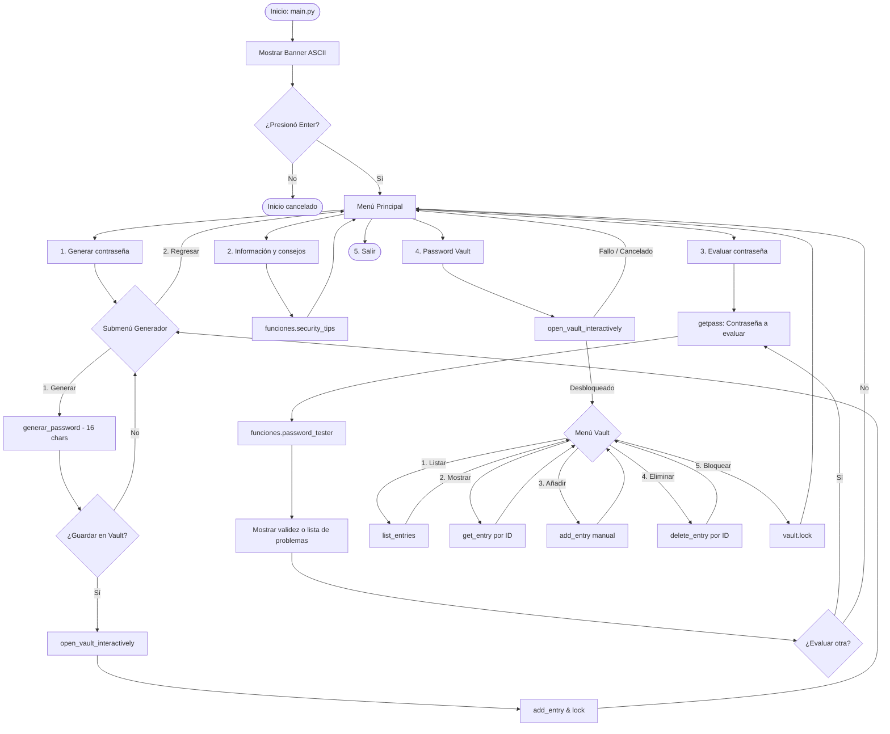
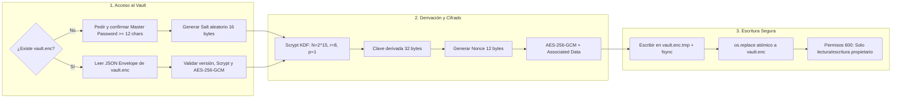

# Arquitectura y Flujo del Sistema — Password Generator & Vault

Documentación técnica del flujo de ejecución, validación de contraseñas y almacenamiento cifrado en `vault.enc`.

---

## 1. Diagrama de Flujo Principal (CLI)

---

## 2. Flujo de Autenticación y Cifrado (`PasswordVault`)

Detalle de cómo `VaultService` y `PasswordVault` gestionan la derivada de claves y la escritura atómica en disco:

---

## 3. Estructura de Módulos

| Archivo | Responsabilidad |
| :--- | :--- |
| `main.py` | Punto de entrada principal, menús interactivos y coordinación general. |
| `Password_Generator.py` | Generación criptográficamente segura (`secrets`) garantizando minúsculas, mayúsculas, dígitos y símbolos. |
| `funciones.py` | Reglas de validación de fortaleza (`password_tester`) y consejos de seguridad. |
| `vault_service.py` | Capa de servicio para validar coincidencia de contraseñas maestras (`compare_digest`) e instanciar el vault. |
| `Password_vault.py` | Motor criptográfico (`Scrypt` + `AESGCM`), gestión CRUD de credenciales y escritura atómica en disco. |
